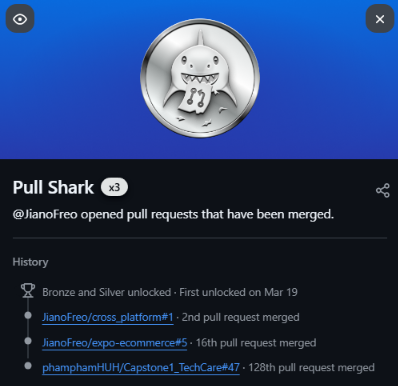
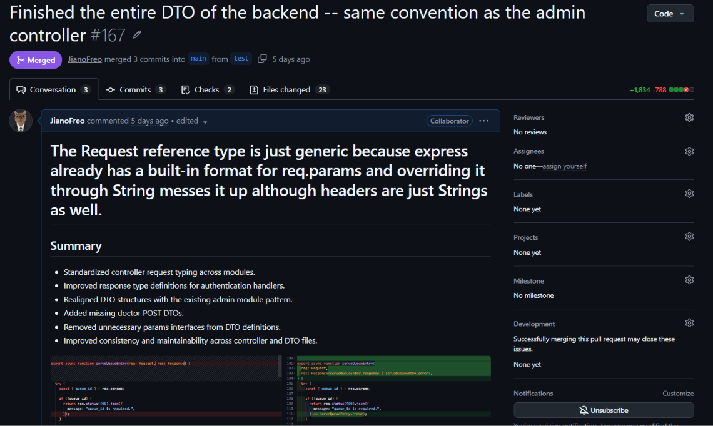

# Git Activity 3 - Magtangob

**# Did you know that merging pull requests on GitHub can earn you the Pull Shark achievement? 🦈 You can earn this badge by opening pull requests and getting them merged into your repository!**

# To earn the achievement, create a branch, push it to GitHub, and open a pull request. Once it gets merged, GitHub can award you the Pull Shark badge!

